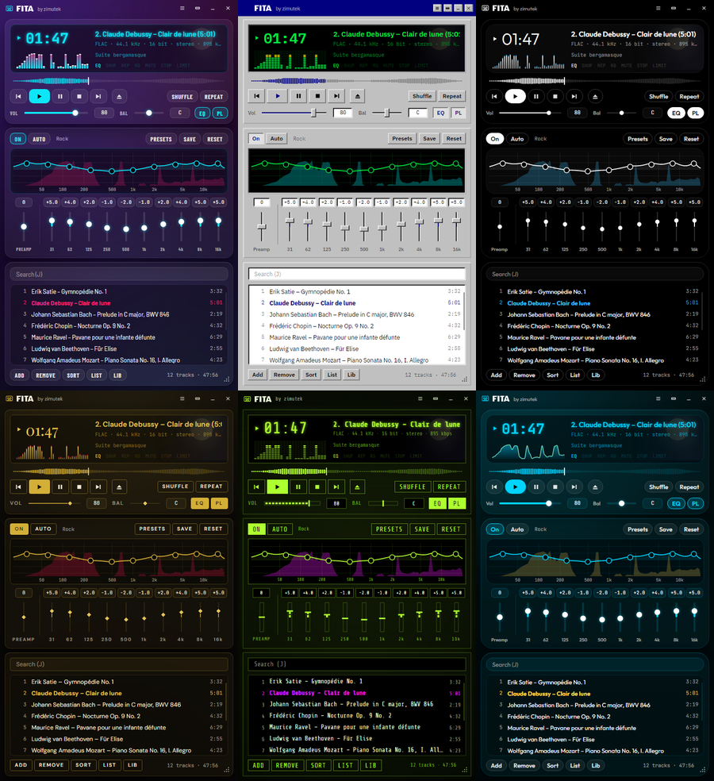

<p align="center">
  
</p>

<h1 align="center">Fita</h1>

<p align="center">
  <b>Plays it all.</b><br>
  A music player for Windows and Linux, in the spirit of the classic Winamp.<br>
  <sub>by zimutek</sub>
</p>

<p align="center">
  <a href="LEIAME.md">Leia-me em português</a> · Windows 10 / 11 · Linux · .NET 10 · ffmpeg · MIT
</p>

<p align="center">
  <a href="https://github.com/zimutes/fita/actions/workflows/compilar.yml"></a>
</p>

<p align="center">
  
</p>

---

> ### Read this first
>
> **Written by AI.** This app (the code, the icon and this README) was written by AI
> (Claude, by Anthropic, through Claude Code) at the author's request, and is shared as-is.
> It was tested on the author's Windows 11 PC and on Debian 13 (X11), with MP3, FLAC, Ogg
> Vorbis, Opus, AAC, WAV, WMA and AIFF files.
>
> **Not affiliated with Winamp.** "Winamp" is a trademark of its owners; Fita only borrows
> the spirit. No warranty of any kind, see [LICENSE](LICENSE).

---

## Why

One small window that opens fast, plays anything you throw at it, shows a spectrum while it
plays and has an equalizer you can actually tune. That was Winamp. Fita (Portuguese for
*tape*, as in a cassette) is that idea, rebuilt for today, on Windows and Linux.

## What it does

- **Plays almost everything**, through ffmpeg: MP3, FLAC, Ogg Vorbis, Opus, AAC/M4A, ALAC,
  WAV, AIFF, WMA, APE, WavPack, Musepack, TTA, DSD (DSF/DFF), AC-3, DTS, Matroska audio and,
  when your ffmpeg has them, tracker modules (MOD, XM, IT, S3M) and game music (NSF, SPC, VGM).
- **Gapless.** The next track is decoded before the current one ends and joins it without a
  gap, so live albums and mixes flow as recorded.
- **Equalizer with real detail.** Ten bands (31 Hz to 16 kHz) with sliders, plus a graph of
  the actual response curve over the live spectrum. Drag a point to move its gain and
  frequency, scroll to change its width (Q), right-click for exact values and the band type:
  bell, low/high shelf, low/high cut. Preamp, *Auto* preamp so boosts never clip, a limiter
  as a safety net, 12 presets and your own.
- **Every level has a box you can type in:** volume, balance (`L30`, `C`, `R30`), preamp and
  each band. Enter applies; empty + Enter or a double-click puts it back to default (volume 80,
  balance centre, 0 dB). Arrows and the mouse wheel move one step.
- **CUE sheets:** a whole album in one FLAC/APE/WAV with a `.cue` next to it plays as its
  separate tracks (open the `.cue`, or add the folder), and one track flows into the next
  with no gap or click, because the same decoder keeps going across the boundary.
- **Playlist:** drag files, folders or M3U/PLS lists in; reorder by dragging; search as you
  type (`J`); sort by title, artist, album, file, folder or length; remove duplicates or
  missing files; save as M3U8 or PLS. It remembers the list, the track and where you stopped.
- **Classic display:** time (click for remaining), scrolling title, format line, spectrum or
  oscilloscope (click to switch), and the little status lights: EQ, shuffle, repeat,
  ReplayGain, stop-after-current, limiter. The album art (from the file, or a `cover.jpg` /
  `folder.jpg` next to it) sits faded behind the text, so the window doesn't grow.
- **Six themes**, taken from the six themes of the panel of Jazmin (the author's CMS): Purple
  Haze, 1995 Calling, Midnight OLED, Boutique Gold, Toxic Terminal and Oceanic Flow. Each one
  changes more than colours: fonts, button shapes, relief or glow, how the sliders and the
  spectrum are drawn, even whether things animate.
- **Compact mode** (the old *windowshade*): the whole player in the title bar.
- **ReplayGain** (track or album). Files without ReplayGain tags are measured in the
  background (EBU R128, with ffmpeg) so they play at the same level too: only the current
  track and the next few, at low priority, and each file once.
- Output device choice, always on top, stop after current.
- **Part of the system:** Fita shows up in the Windows media flyout and on the lock screen
  (on Linux, through MPRIS: GNOME, KDE, `playerctl`) with title, artist, album art and
  position, and takes the media keys and headphone buttons from there, even with the window
  in the background. The keys go to whichever app played last, like with any other player.
  On Windows the taskbar thumbnail has previous, play/pause and next, and the taskbar
  button fills up as the track plays (this can be turned off in the menu).
- **Keyboard first**, with Winamp's keys (below).
- **One instance:** opening files with Fita already open adds them to it. On Windows,
  *Open with*, and right-click on folders and audio files gives *Play in Fita* and
  *Add to Fita playlist*, with any number of items selected (they go in as one batch, in
  natural order).
- **English or Portuguese.**

### Keys

| Keys | |
|---|---|
| `Z` `X` `C` `V` `B` | Previous · play · pause · stop · next |
| `Space` | Play / pause |
| `←` `→` | Back / forward 5 s (`Ctrl`: 30 s) |
| `↑` `↓` | Volume |
| `J` | Search the playlist |
| `L` · `Shift+L` | Add files · add a folder |
| `S` · `R` | Shuffle · repeat (off, all, one) |
| `Alt+G` · `Alt+E` | Show the equalizer · the playlist |
| `Ctrl+W` | Compact mode |
| `Ctrl+T` | Elapsed / remaining time |
| `T` | Next theme |
| `Ctrl+V` | Stop after the current track |
| `Enter` · `Del` · `Alt+↑↓` | Play · remove · move the selected tracks |

## What you need

- **[ffmpeg](https://ffmpeg.org)**, free: `winget install Gyan.FFmpeg` on Windows,
  `sudo apt install ffmpeg` on Debian/Ubuntu, `sudo dnf install ffmpeg-free` on Fedora (or
  your distro's package; Fedora's `ffmpeg-free` already plays AAC, WMA and ALAC). Fita finds it by
  itself (winget, Chocolatey, Scoop, `PATH`, or a portable copy in an `ffmpeg/bin` folder next
  to the app); if it can't, it tells you and lets you point to it. ffmpeg is not bundled.
- **Windows 10 or 11 (x64)**, or **Linux** (x64 or arm64) with X11 or XWayland (tested on
  Debian and Fedora 44; on GNOME/KDE with Wayland it runs through XWayland, which they ship).
- To build: the [.NET 10 SDK](https://dotnet.microsoft.com/download/dotnet/10.0)
  (Fedora: `sudo dnf install dotnet-sdk-10.0`).

## Install

There are no downloads yet, so build it from source:

**Windows** (PowerShell):

```powershell
git clone https://github.com/zimutes/fita
cd fita
.\tools\publicar.ps1              # builds and installs for the current user
.\tools\publicar.ps1 -Autonomo    # self-contained, no .NET runtime needed
.\tools\publicar.ps1 -SemMenus    # without the right-click entries in Explorer
```

It installs to `%LOCALAPPDATA%\Programs\Fita`, adds **Fita** to the Start menu and to
*Open with* for audio files (and to Windows' *Default apps*, without becoming the
default), and (unless `-SemMenus`) adds *Play in Fita* / *Add to Fita
playlist* to the right-click menu of folders and audio files. No admin rights needed. To
remove it: `.\tools\desinstalar.ps1` (`-Tudo` also deletes the settings, `-WhatIf` shows
what it would do).

**Linux**:

```sh
git clone https://github.com/zimutes/fita
cd fita
./tools/instalar.sh               # builds and installs for the current user
./tools/instalar.sh --remover     # removes it
```

It installs to `~/.local/opt/fita`, with an `fita` command in `~/.local/bin` and an entry
in your applications menu (with *Open with* for audio files and *Add to playlist*).

When releases exist, they carry a small `Fita.exe` (needs the .NET 10 runtime), a
self-contained Windows zip and self-contained Linux packages (`./fita/instalar.sh` installs
the one that comes with it).

## How it works

- **Decoding:** one ffmpeg process per track (and per seek), writing 32-bit float stereo at
  the output's sample rate into a pipe.
- **Engine:** a decoding thread keeps about two seconds in a queue; an output thread takes
  blocks of 1024 samples, runs them through the equalizer (biquad filters, RBJ cookbook,
  double precision), volume and balance (ramped, no clicks) and a peak limiter, and hands
  them to **OpenAL Soft** (WASAPI on Windows, PipeWire/PulseAudio/ALSA on Linux), with HRTF
  off so headphones get plain stereo. Track boundaries travel inside the queue, which is what
  makes playback gapless and keeps the display in sync with what you hear.
- **Spectrum:** a 2048-point FFT of the samples being heard, 60 times a second.
- **Tags:** TagLib#, with ffprobe as a fallback for formats it doesn't know.
- **Interface:** Avalonia, with every control that matters drawn by hand so the themes can
  change their shape, not just their colour.

## Security

Fita opens files you didn't make, through ffmpeg, so:

- **No shell.** ffmpeg is started directly, with the arguments passed as a list, so a file
  name can never turn into an extra option or command.
- **Local files and audio formats only.** Inputs are opened with `-protocol_whitelist file`
  and a `-format_whitelist` of audio demuxers. ffmpeg detects formats by content, not by
  extension; without this, a file disguised as `.mp3` (an HLS or concat playlist, for
  example) could make it fetch URLs or read other files. Playlists (M3U/PLS) only add local
  files; URLs are ignored.
- **`file:` prefix** on every path, so a name is never read as a protocol.
- **No planted executables.** ffmpeg is looked up only where installers put it, never in the
  current folder or loose next to the app; Explorer is started by its full path.
- **Single instance, current user only:** the pipe that passes files to the running window
  only accepts connections from the same user.
- No network access, no telemetry, no admin rights. Settings and the playlist live in
  `%APPDATA%\Fita` (Windows) or `~/.config/fita` (Linux), and errors in `log.txt` there.

## Build

```sh
dotnet build Fita.slnx -c Release
dotnet test tests/Fita.Tests
```

- `src/Fita/Audio/`: the engine (`AudioEngine`), ffmpeg (`FfmpegDecoder`, `FfmpegLocator`),
  OpenAL (`OpenAl`, `AlOutput`), the equalizer (`Equalizer`) and the spectrum (`SpectrumAnalyzer`).
- `src/Fita/Library/`: tracks, playlist order (shuffle, repeat), M3U/PLS, CUE sheets, tags,
  album art.
- `src/Fita/Themes/`: the six themes (`Catalog`) and how they are applied (`ThemeManager`).
- `src/Fita/Controls/`: hand-drawn controls (sliders, spectrum, EQ graph, scrolling title).
- `src/Fita/Views/`: the window, split by area (playback, playlist, EQ, menus, frame).
- `src/Fita/Loc.cs`: every piece of UI text, in English and Portuguese.
- `Fita --selftest file…` plays files through the whole engine silently, without a window.
- `tools/Capturas` draws the window in every theme without a screen (the pictures above).
- `tools/gerar-icone.ps1` draws the icon.
- A tag `v*` makes GitHub Actions publish a release (Windows and Linux) with `SHA256SUMS`.

## License

[MIT](LICENSE) © zimutek. Third-party parts (OpenAL Soft, TagLib#, Avalonia, the fonts) keep
their own licenses: see [THIRD-PARTY-NOTICES.md](THIRD-PARTY-NOTICES.md). ffmpeg is a separate
project with its own license and is not included.
